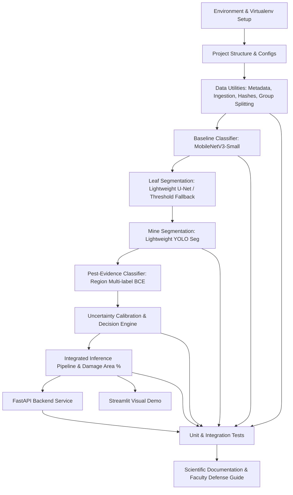

# PhytoTrace AI — Implementation Plan

**Project:** Explainable AI for Mixed Leaf-Miner Infestation Detection, Damage Assessment and Progression Monitoring in Tomato Crops  
**Target Organisms:** *Tuta absoluta* (Tomato pinworm/leaf miner) and *Liriomyza* spp. (Serpentine leaf miner)  
**Hardware Environment:** Apple M5 (arm64, 16 GB unified memory, macOS), Apple MPS acceleration with CPU fallback  

---

## 1. Objectives & Architectural Principles

1. **Rigorous Modularity:** Separate image quality, leaf segmentation, mine segmentation, region evidence classification, uncertainty calibration, and decision engine into independently verifiable modules.
2. **Scientific Integrity:** 
   - Never confuse leaf-mining damage detection with pest species identification.
   - Genuine mixed infestation requires multi-region evidence and expert verification.
   - Never fabricate trained weights or claim accuracy without real, verified training data.
3. **Hardware-Conscious Training:** Optimized for Apple Silicon MPS, low memory footprint (16 GB unified memory), gradient clipping, checkpointing, and dynamic batch sizing.

---

## 2. Phased Roadmap & Dependency Graph

---

## 3. Detailed Phase Breakdown & Acceptance Criteria

### Phase 1: Environment & Virtualenv Setup
- **Action:** Create virtual environment `.venv` using Python 3.15 arm64; install PyTorch, torchvision, ultralytics, opencv-python-headless, scikit-learn, fastapi, uvicorn, streamlit, pytest, etc.
- **Verification:** MPS smoke test script verifying forward/backward pass on `mps` with CPU fallback.

### Phase 2: Project Layout & Configuration Management
- **Action:** Scaffold directory structure (`configs/`, `data/`, `src/phytotrace/`, `scripts/`, `tests/`, `notebooks/`, `models/`, `experiments/`, `reports/`, `demo/`, `docs/`).
- **Files:** `pyproject.toml`, `requirements.txt`, `.gitignore`, `configs/*.yaml`.
- **Verification:** Import paths resolve cleanly; YAML configurations parse without schema errors.

### Phase 3: Dataset Ingestion, Metadata & Group-Aware Splitting
- **Action:**
  - Standardized metadata CSV schema (24 columns covering plant_id, farm_id, leaf_id, confirmation method, etc.).
  - Image ingestion with SHA-256 exact deduplication & perceptual hash (dHash).
  - EXIF rotation handling and corrupted image quarantine.
  - Group-aware train/val/test splitting (70/15/15) by farm_id/plant_id/leaf_id to prevent data leakage.
- **Verification:** Unit tests proving zero group ID leakage between splits; synthetic fixtures tested.

### Phase 4: Baseline Image Classifier (MobileNetV3-Small)
- **Action:**
  - 3-class classifier: `healthy`, `leaf_miner_damage`, `other_damage`.
  - Transfer learning pipeline with head freezing and fine-tuning.
  - Augmentation pipeline preserving fine serpentine mine structures.
- **Verification:** Forward/backward pass on MPS; metric calculation (accuracy, macro F1, per-class PR, confusion matrix).

### Phase 5: Leaf & Mine Segmentation
- **Action:**
  - Leaf segmenter: Lightweight U-Net with binary cross-entropy + Dice loss.
  - Mine segmenter: YOLO segmentation integration with polygon parsing.
  - Damage calculation engine: Union of mine polygons intersected with leaf mask to calculate exact visible damage percentage.
- **Verification:** Synthetic mask test verifying pixel intersection and handling of empty/overlapping masks.

### Phase 6: Pest-Evidence Multi-Label Classifier
- **Action:**
  - Region-based multi-label model for `tuta_evidence` and `liriomyza_evidence` with independent sigmoid logits.
  - Masked BCE loss supporting missing/unverified species annotations without false negatives.
  - Clear `DATA_NOT_READY` reporting when verified species annotations are absent.
- **Verification:** Test handling of unlabelled and partial species data.

### Phase 7: Uncertainty Calibration & Decision Engine
- **Action:**
  - Temperature scaling and threshold calibration.
  - Conservative rule-based decision engine (`no_visible_mine`, `mine_detected_species_uncertain`, `possible_tuta`, `possible_liriomyza`, `possible_mixed`, `image_quality_insufficient`, `other_damage`).
  - Clear warning and abstention output when confidence is below calibrated threshold.
- **Verification:** Decision engine unit tests on all branch cases.

### Phase 8: Integrated Inference Pipeline & Local API
- **Action:**
  - Unified `InferencePipeline` class chaining validation -> leaf mask -> mine localization -> pest evidence -> calibration -> decision -> visualization.
  - FastAPI app with `/health`, `/models`, `/predict`, `/predict/batch`, `/version`.
- **Verification:** API tests using `TestClient` with synthetic test images.

### Phase 9: Streamlit Demonstration Application
- **Action:**
  - Interactive UI with PhytoTrace theme (deep forest green, mint, white).
  - Single photograph upload, side-by-side masks, regional evidence, calibrated uncertainty, downloadable JSON report.
  - Prominent "Model Not Trained" / "Synthetic Simulation" indicators when checkpoints are absent.
- **Verification:** App executes and renders without runtime exceptions.

### Phase 10: Test Suite, Verification & Scientific Documentation
- **Action:**
  - Comprehensive PyTest suite covering data, splitting, preprocessing, model shapes, decision engine, severity, inference, and API.
  - `docs/faculty_explanation.md` addressing all 20 faculty questions + 3-min and 8-min presentation scripts + Mermaid architecture diagrams.
  - Collector guide (`docs/dataset_collection_guide.md`) and annotation protocol (`docs/annotation_protocol.md`).
- **Verification:** All tests passing (`pytest` exits with code 0).

