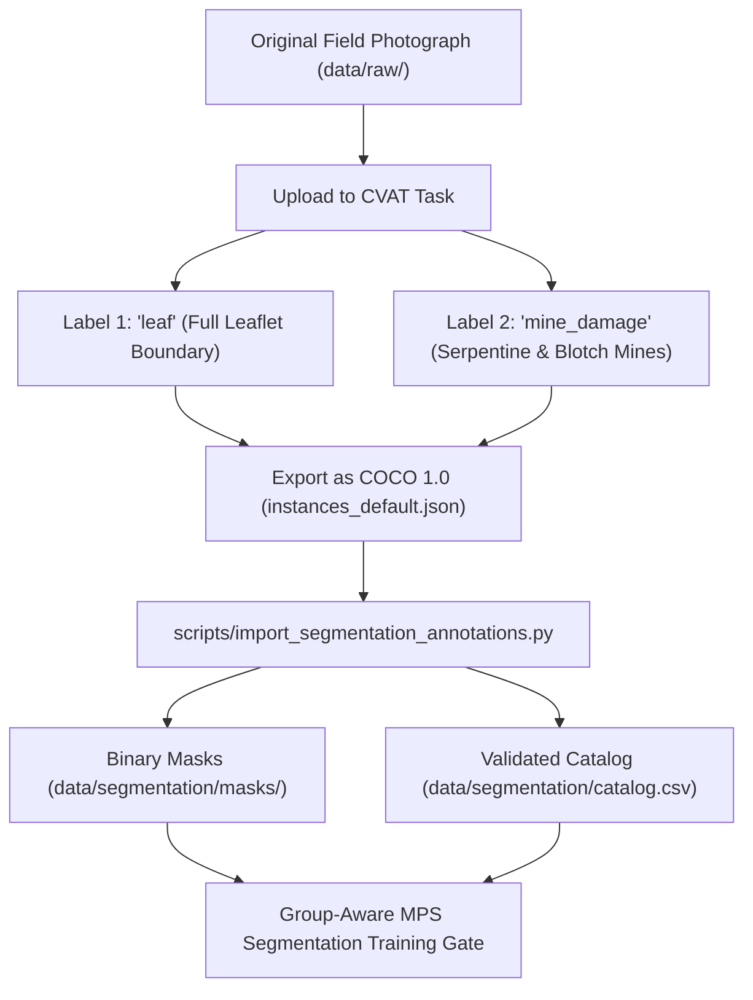

# PhytoTrace AI — Phase 3 CVAT Annotation Protocol & Practical Workflow Guide

**Target Task:** Pixel-Level Leaf Boundary & Leaf-Miner Damage Segmentation  
**Annotation Tool:** Computer Vision Annotation Tool (CVAT) ([cvat.ai](https://cvat.ai) or local Docker instance)  
**Input Dataset:** `/Users/jeevithp/Desktop/PhyToTrace/data/raw/original_photos/`  
**Target Export Format:** `COCO 1.0` (`instances_default.json`)  
**Ingestion Target:** `data/segmentation/annotations/` & `data/segmentation/masks/`  

---

## 1. Overview & Scientific Objective

Phase 3 transitions PhytoTrace from whole-image classification (MobileNetV3) to **pixel-accurate spatial damage localization**. 

Our baseline evaluation revealed that downsampling 12MP leaf photographs to $224\times224$ pixels reduces early serpentine leaf mines ($<3\%$ leaf surface) to sub-pixel noise, causing a $28.6\%$ test recall. 
To overcome this limitation, Phase 3 trains high-resolution instance segmentation models (Lightweight U-Net and YOLOv8n-seg) directly on leaf boundaries and active mine galleries.



---

## 2. Standardized Label Definitions

Only two labels are permitted in CVAT for Phase 3:

| Label Name | CVAT Shape | Recommended Color | Biological Scope & Definition |
| :--- | :---: | :---: | :--- |
| **`leaf`** | **Polygon** | `#00FF00` (Emerald Green) | The complete visible perimeter of the target tomato leaflet, including serrated lobes, apex, and petiolule. Excludes background soil, wooden stakes, human fingers, clips, and blurred neighboring foliage. |
| **`mine_damage`** | **Polygon** | `#FF3333` (Crimson / Red) | Any visible serpentine trail, translucent epidermal feeding tunnel, or blotch mine caused by leaf miner larvae (*Tuta absoluta* or *Liriomyza* spp.). |

> [!IMPORTANT]
> **Strict Scientific Rule — Species-Agnostic Damage Localization:**
> **Do NOT label mines with insect species names** (e.g., `tuta`, `liriomyza`, `tuta_absoluta`).
> Larval mine morphology can overlap between early *Tuta* and *Liriomyza* depending on instar, host vigor, and leaflet age. Phase 3 focuses solely on *where* damage exists and *how much* surface is consumed. Species discrimination is handled downstream in Phase 4 using morphological evidence classifiers.

---

## 3. Step-by-Step CVAT Setup & Annotation Instructions

### Step 1: Create a CVAT Task
1. Open CVAT in your browser: [app.cvat.ai](https://app.cvat.ai) (or your local CVAT server at `http://localhost:8080`).
2. Log in and click **+ Create a new task**.
3. Set **Task Name**: `PhytoTrace-Phase3-Segmentation-Pilot` (or `PhytoTrace-Phase3-All-95`).
4. In the **Labels** section, configure exactly two labels:
   - Click **Add label** $\rightarrow$ Name: `leaf` $\rightarrow$ Change type to **Polygon** $\rightarrow$ Color: Green.
   - Click **Add label** $\rightarrow$ Name: `mine_damage` $\rightarrow$ Change type to **Polygon** $\rightarrow$ Color: Red.
5. In the **Files** section:
   - Click **Connected file share** or **My computer**.
   - For the 18-image pilot: select the 18 files listed in `data/segmentation/pilot_manifest.csv`.
   - For the full 95 images: select all files from `/Users/jeevithp/Desktop/PhyToTrace/data/raw/original_photos/`.
   - **Image Quality**: Set to **100** (do not compress).
6. Click **Submit & Open**.

---

### Step 2: Polygon Drawing Protocols

#### A. Tracing the Leaf (`leaf`)
1. Press `N` on your keyboard, select `leaf` (Shape: `Polygon`), and click around the leaflet contour.
2. **Margin Precision:** Trace closely along the serrated leaf margin. Place vertices $10\text{--}20$ pixels apart along curving lobes.
3. **Primary Leaflet Focus:** If multiple leaflets appear in a compound leaf photograph, trace the primary target leaflet occupying the center of the frame. If secondary leaflets are prominently visible, trace them as separate `leaf` polygon instances.
4. **Exclusions:**
   - Cut around human fingers, gloves, clips, and scissors holding the foliage.
   - Cut around blurred background foliage that belongs to neighboring plants.
   - Include the petiolule (leaf stalk) up to where it meets the main stem.

#### B. Tracing Mine Damage (`mine_damage`)
1. Press `N`, select `mine_damage` (Shape: `Polygon`).
2. **Serpentine Tunnels:** Trace along the outer perimeter of the whitish, translucent mine track. Include the dark frass (fecal grains) visible inside the tunnel.
3. **Multiple Separate Mines:** If a leaf contains multiple distinct serpentine trails, trace each one as a separate `mine_damage` polygon instance.
4. **Irregular Blotch Mines:** Trace the complete outer boundary of the hollowed, necrotic epidermal blotch.
5. **Pinhead Feeding Punctures:** Clustered pinhead punctures can be captured with a localized polygon enclosing the cluster. Isolated punctures $<5$ pixels across can be omitted if indistinguishable from background texture.
6. **Leaf Containment Constraint:** **Every `mine_damage` polygon must lie biologically inside the `leaf` polygon.** The automated ingestion script will reject or flag any mine annotation whose vertices extend into background space.

#### C. Negative (Healthy) Leaflet Protocol
- For healthy leaflets with zero infestation:
  - **Trace the `leaf` polygon normally.**
  - **Do NOT draw any `mine_damage` polygon.**
  - Leave the mine label untouched. The PhytoTrace ingestion engine will register this as a **verified negative mine mask** ($0$ damage pixels across the entire leaf).

#### D. Non-Miner Damage Exclusion (`other_damage`)
- Do **NOT** trace:
  - Circular dark fungal spots with concentric rings (e.g., *Alternaria solani* early blight).
  - Tiny dark bacterial specks (*Pseudomonas*).
  - Clean mechanical tears, holes, or wind abrasion scars.
  - Natural chlorosis (yellowing) halos surrounding the leaf margin.
- If unsure whether a lesion is an aged blotch mine vs fungal necrosis, check for larval frass pellets: frass indicates insect mining; powdery sporulation or concentric rings indicate fungal pathology.

---

### Step 3: Saving and Exporting Annotations

1. Frequently save your work in CVAT (`Cmd + S` or `Ctrl + S`).
2. Once all target images are annotated:
   - Click **Menu** (top left hamburger icon) $\rightarrow$ **Export Task Dataset**.
   - Select Export Format: **`COCO 1.0`** (do not select CVAT XML or Pascal VOC).
   - Ensure *Save Images* is unchecked (to keep the download lightweight).
   - Click **Export** and save the resulting `.zip` file.
3. Extract the downloaded zip archive. Locate the annotation file:
   - In CVAT COCO exports, this is located inside the `annotations/` folder and typically named `instances_default.json`.
4. Copy `instances_default.json` into your PhytoTrace project:
   ```bash
   cp /path/to/downloaded/annotations/instances_default.json /Users/jeevithp/Desktop/PhyToTrace/data/segmentation/annotations/instances_default.json
   ```

---

### Step 4: Automated Ingestion into PhytoTrace

Run the automated ingestion and validation script:

```bash
cd /Users/jeevithp/Desktop/PhyToTrace
.venv/bin/python scripts/import_segmentation_annotations.py \
    --coco_json data/segmentation/annotations/instances_default.json \
    --reviewer "your_name" \
    --generate_overlays
```

The script automatically:
1. Validates image IDs, dimensions, and polygon vertex topology.
2. Enforces biological containment (flagging mines that spill outside leaf margins).
3. Distinguishes unannotated images from verified negative leaves.
4. Generates binary uint8 PNG masks in `data/segmentation/masks/leaf/` and `data/segmentation/masks/mine/`.
5. Updates `data/segmentation/catalog.csv` with exact damage percentages and training readiness flags.
6. Generates visual comparison overlays in `data/segmentation/masks/visualizations/`.
