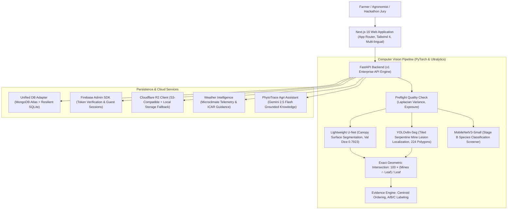

# PhytoTrace AI — System Architecture & Data Flow

**Institution:** Presidency University, Bengaluru  
**Project:** PhytoTrace AI — Real-Model Agricultural Intelligence Platform  
**Target Evaluation:** ICAR-IIHR Tomato Disease & Pest Hackathon

---

## 1. High-Level Architecture Overview

---

## 2. Component Details

### 2.1 Frontend (`frontend/`)
- **Framework:** Next.js 16 (Turbopack) with React 19 and TypeScript.
- **Styling:** Tailwind CSS v4 with custom dark botanical emerald design system tokens (`#0A1814`, `#10231B`, `#152C22`, `#6AE6A0`).
- **State Management & Contexts:**
  - `LanguageContext.tsx`: Manages active locale (`en`, `kn`, `hi`) with local persistence and full UI string translation dictionaries.
  - `AuthContext.tsx`: Manages guest sessions, Google Sign-In, and user profile state.
- **Interactive Visualizers:**
  - `LayerToggleViewer.tsx`: Pixel-aligned overlay toggle, opacity slider, zoom controls (75% to 300%), and interactive region selection pills (Region A, B, C...).
  - `SeverityGauge.tsx`: Arc meter showing exact surface damage percentage with pixel counts.
  - `TrendChart.tsx`: SVG trajectory chart rendering longitudinal damage changes across sequential scans.

### 2.2 Backend (`src/phytotrace/`)
- **FastAPI Core (`src/phytotrace/api/`):**
  - Legacy routes: `/api/health`, `/api/models`, `/api/predict`, `/api/inspections`, `/api/farms`, `/api/plants/{id}/timeline`.
  - Versioned Enterprise routes: `/api/v1/health`, `/api/v1/models/status`, `/api/v1/analyze`, `/api/v1/analyses/{id}/regions`, `/api/v1/users/me`, `/api/v1/weather/current`, `/api/v1/weather/crop-advice`, `/api/v1/assistant/chat`.
- **Inference Pipeline (`src/phytotrace/inference/`):**
  - `pipeline.py`: Orchestrates preflight quality checks, U-Net leaf segmentation, YOLOv8n-Seg lesion localization, MobileNetV3 screening, and deterministic centroid-sorted A/B/C labeling.
  - `severity.py`: Implements $100 \times (\text{Mines} \cap \text{Leaf}) / \text{Leaf}$ with polygon union merging to prevent double counting.
  - `visualization.py`: Renders visual overlays with circular A/B/C region badges.

### 2.3 Persistence & Storage
- **MongoDB Atlas (`src/phytotrace/db/mongo.py`):**
  - Manages collections for `users`, `farms`, `plants`, `inspections`, `evidence_regions`, `weather_snapshots`, and `assistant_sessions`.
  - Automatically falls back to local SQLite repository (`data/phytotrace.db`) when `MONGODB_URI` is unconfigured.
- **Cloudflare R2 (`src/phytotrace/storage/r2.py`):**
  - S3-compatible client for storing raw photographs, segmentation masks, and overlays with pre-signed URLs.
  - Falls back to `data/storage/` on local disk when R2 credentials are unset.

