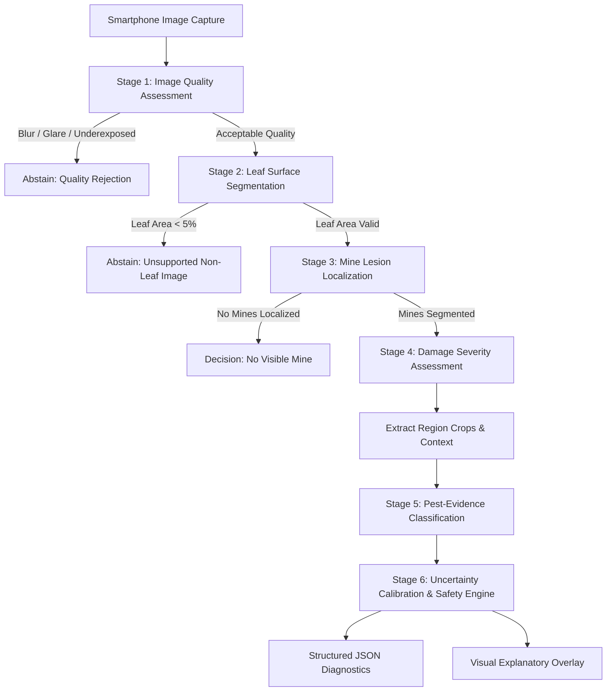

# PhytoTrace AI — System Architecture Specification

## 1. Executive Summary

**PhytoTrace** is an explainable computer vision and uncertainty-calibrated diagnostic system for detecting and assessing mixed leaf-miner infestations in tomato (*Solanum lycopersicum*). It targets two primary insect pests:
1. *Tuta absoluta* (Tomato leaf miner / pinworm — Lepidoptera: Gelechiidae)
2. *Liriomyza* spp. (Serpentine leaf miner — Diptera: Agromyzidae)

Rather than reducing a tomato leaf image to an oversimplified single-label verdict, PhytoTrace implements a **multi-stage diagnostic workflow** that separates visible damage detection from insect species identification, assesses localized damage severity, and explicitly abstains when visual evidence is insufficient or ambiguous.

---

## 2. Multi-Stage Pipeline Architecture

### Stage 1: Image Quality Assessment
- **Engine:** `phytotrace.preprocessing.quality`
- **Metrics Evaluated:**
  - Variance of the Laplacian ($\sigma^2_{Lap}$) to detect camera motion and defocus blur (default threshold: 100.0).
  - Mean luminance in grayscale and LAB color spaces to flag underexposure (< 30) or extreme sunlight glare (> 235).
  - Spatial resolution threshold (minimum 256x256 px).
- **Behavior on Failure:** Immediate, safe abstention with diagnostic feedback requesting re-capture.

### Stage 2: Leaf Surface Segmentation
- **Engine:** `phytotrace.models.leaf_segmenter`
- **Architecture:** Lightweight U-Net encoder-decoder operating on 256x256 resolution, coupled with a morphological color-space fallback.
- **Responsibility:** Produces a binary mask representing the total visible leaf canopy ($A_{leaf}$).
- **Failure Safeguard:** If leaf surface occupies less than 5% of the frame, the image is classified as `unsupported_image`.

### Stage 3: Mine Damage Localization & Segmentation
- **Engine:** `phytotrace.models.mine_segmenter`
- **Architecture:** Lightweight Ultralytics YOLO segmentation nano model (`yolo11n-seg`).
- **Responsibility:** Delineates individual mining lesion polygons and bounding boxes.
- **Class Label:** Single `leaf_miner_damage` category to avoid unvalidated species claims at the visual segmentation level.

### Stage 4: Damage Severity Calculation
- **Engine:** `phytotrace.inference.severity`
- **Formula:**
  $$\text{Visible Damage Percentage} = 100.0 \times \frac{\sum (M_{mined} \cap M_{leaf})}{\sum M_{leaf}}$$
- **Integrity Principles:**
  - Mines are strictly intersected with the leaf mask.
  - The geometric union of overlapping mine detections is computed to eliminate double counting.
  - Generates clear disclaimers that surface leaf damage is not an economic yield loss estimate.

### Stage 5: Pest-Evidence Multi-Label Classification
- **Engine:** `phytotrace.models.species_classifier`
- **Architecture:** MobileNetV3-Small feature extractor with independent dual-sigmoid heads:
  - Output 0: $s_{Tuta} \in [0, 1]$ (Evidence consistent with *Tuta absoluta* blotch mines)
  - Output 1: $s_{Liriomyza} \in [0, 1]$ (Evidence consistent with *Liriomyza* serpentine mines)
- **Objective Function:** Masked Binary Cross-Entropy with Logits (`MaskedBCEWithLogitsLoss`), ensuring unverified or unknown samples are not incorrectly penalized as negatives.

### Stage 6: Uncertainty Calibration & Decision Engine
- **Engine:** `phytotrace.models.decision_engine`
- **Calibration:** Post-hoc temperature scaling on held-out validation sets.
- **Allowed Final Decisions:**
  1. `no_visible_mine`
  2. `mine_detected_species_uncertain` (Conservative fallback)
  3. `possible_tuta`
  4. `possible_liriomyza`
  5. `possible_mixed`
  6. `other_damage`
  7. `image_quality_insufficient`
  8. `unsupported_image`
- **Safety Policy:** Predictions never prescribe chemical pesticides. If evidence scores fall within the uncertainty margin ($\pm 0.15$ of threshold), the engine forces abstention to `mine_detected_species_uncertain`.

---

## 3. Hardware Optimization for Apple Silicon

The entire system is optimized to train and evaluate within 16 GB of unified memory on Apple M-series chips:
1. **Device Driver:** Dynamic selection of Apple Metal Performance Shaders (`mps`) with automatic CPU fallback. CUDA dependencies are completely excluded.
2. **Memory Footprint:** Baseline MobileNetV3 requires under 150 MB VRAM; YOLO nano requires under 450 MB VRAM.
3. **Data Loading:** Threading configured to prevent macOS multiprocessing deadlocks.

