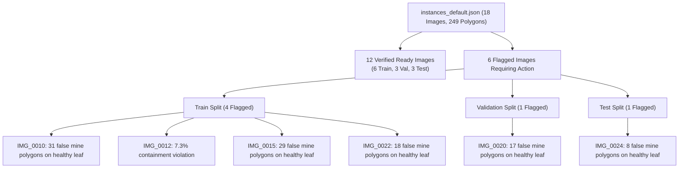

# PhytoTrace AI — Phase 3 CVAT Pilot Annotation Diagnostic & Action Checklist

**Audit Date:** 2026-11-04  
**Annotation File Inspected:** [`data/segmentation/annotations/instances_default.json`](file:///Users/jeevithp/Desktop/PhyToTrace/data/segmentation/annotations/instances_default.json)  
**Catalog Inspected:** [`data/segmentation/catalog.csv`](file:///Users/jeevithp/Desktop/PhyToTrace/data/segmentation/catalog.csv)  
**Pilot Manifest:** [`data/segmentation/pilot_manifest.csv`](file:///Users/jeevithp/Desktop/PhyToTrace/data/segmentation/pilot_manifest.csv)  
**Reviewer Decisions Ledger:** [`data/segmentation/reviewer_decisions.csv`](file:///Users/jeevithp/Desktop/PhyToTrace/data/segmentation/reviewer_decisions.csv)  
**Total Pilot Images:** 18  

---

## 1. Executive Summary & Current Status

### COCO Export Diagnostic
- **Total Registered Images:** 18 / 18 matched.
- **Total Annotations:** 249 annotations (19 `leaf` polygons, 230 `mine_damage` polygons).
- **Completed Leaf Boundary Masks:** 18 / 18 (10 Train, 4 Val, 4 Test).
- **Completed Mine Damage Masks:** 12 / 18 (6 Train, 3 Val, 3 Test).
- **Verified Negative Empty Mine Masks:** 0 (awaiting deletion of spurious mine polygons on healthy leaves in CVAT).
- **Quality Warnings / Action Required:** Exactly **6 images** (4 Train, 1 Val, 1 Test).
- **Pilot Readiness Progress:** 12 / 18 verified ready.
  - **Train Partition:** 6 / 10 verified ready (4 flagged).
  - **Validation Partition:** 3 / 4 verified ready (1 flagged).
  - **Test Partition:** 3 / 4 verified ready (1 flagged, strictly frozen).
- **Training Gate Status:**
  - **Lightweight U-Net (Leaf Canopy):** 🟢 **READY** (10 / 10 train leaf masks completed).
  - **YOLOv8n-Seg (Mine Instances):** 🔴 **LOCKED** (6 / 10 verified training samples ready; 4 samples required to unlock).



---

## 2. Filename-by-Filename Diagnostic & Action Checklist

| Order | Image ID | Filename | Split | Class (Meta) | Leaf Polys | Mine Polys | Outside % | Reviewer Decision | Status & Required Action in CVAT |
| :---: | :--- | :--- | :---: | :--- | :---: | :---: | :---: | :--- | :--- |
| **01** | `IMG_0001` | `5558326.jpg` | `train` | `leaf_miner_damage` | 1 | 8 | 0.0% | `confirmed_mine` | 🟢 **Ready** — Verified blotch mine galleries. |
| **02** | `IMG_0002` | `5558327.jpg` | `val` | `leaf_miner_damage` | 1 | 1 | 0.0% | `confirmed_mine` | 🟢 **Ready** — Verified serpentine mine track. |
| **03** | `IMG_0003` | `5595347.jpg` | `test` | `other_damage` | 1 | 5 | 0.3% | `confirmed_mine` | 🟢 **Ready** — Entomological review confirms co-occurring mines. |
| **04** | `IMG_0004` | `5595348.jpg` | `train` | `other_damage` | 2 | 2 | 4.6% | `confirmed_mine` | 🟢 **Ready** — Compound leaf (2 leaflets rasterized to 1 mask). |
| **05** | `IMG_0006` | `5595350.jpg` | `train` | `leaf_miner_damage` | 1 | 1 | 0.0% | `confirmed_mine` | 🟢 **Ready** — Verified serpentine mine track. |
| **06** | `IMG_0007` | `5595351.jpg` | `test` | `leaf_miner_damage` | 1 | 1 | 0.0% | `confirmed_mine` | 🟢 **Ready** — Verified serpentine mine track. |
| **07** | `IMG_0008` | `5595360.jpg` | `train` | `leaf_miner_damage` | 1 | 21 | 0.0% | `confirmed_mine` | 🟢 **Ready** — Multi-gallery cluster. |
| **08** | `IMG_0009` | `BLK_3_1002_PL009_NH.JPG` | `train` | `leaf_miner_damage` | 1 | 10 | 0.4% | `confirmed_mine` | 🟢 **Ready** — Field-collected serpentine mines. |
| **09** | `IMG_0010` | `BLK_3_1002_PL010_H.JPG` | `train` | `healthy` | 1 | **31** | 0.3% | `needs_correction` | 🔴 **ACTION (CVAT): DELETE ALL 31 MINE POLYGONS.** Keep green `leaf` polygon. Traced veins/glare. Deletion unlocks verified negative mask. |
| **10** | `IMG_0011` | `BLK_3_1002_PL014_NH.JPG` | `test` | `leaf_miner_damage` | 1 | 23 | 1.5% | `confirmed_mine` | 🟢 **Ready** — Extensive mine network. |
| **11** | `IMG_0012` | `BLK_3_1002_PL015_NH.JPG` | `train` | `leaf_miner_damage` | 1 | 25 | **7.3%** | `needs_correction` | 🟡 **ACTION (CVAT): ADJUST MINE VERTICES.** 7.3% of mine area protrudes past leaf border ($>5\%$ limit). Pull vertices inside green leaf contour. |
| **12** | `IMG_0014` | `BLK_3_1002_PL019_NH.JPG` | `train` | `leaf_miner_damage` | 1 | 15 | 1.7% | `confirmed_mine` | 🟢 **Ready** — 15 confirmed mine regions. |
| **13** | `IMG_0015` | `BLK_3_1002_PL021_H.JPG` | `train` | `healthy` | 1 | **29** | 1.0% | `needs_correction` | 🔴 **ACTION (CVAT): DELETE ALL 29 MINE POLYGONS.** Keep green `leaf` polygon. Healthy foliage check. |
| **14** | `IMG_0020` | `BLK_3_1002_PL027_H.JPG` | `val` | `healthy` | 1 | **17** | 2.0% | `needs_correction` | 🔴 **ACTION (CVAT): DELETE ALL 17 MINE POLYGONS.** Keep green `leaf` polygon. Healthy foliage check. |
| **15** | `IMG_0022` | `BLK_3_1002_PL029_H.JPG` | `train` | `healthy` | 1 | **18** | 0.6% | `needs_correction` | 🔴 **ACTION (CVAT): DELETE ALL 18 MINE POLYGONS.** Keep green `leaf` polygon. Healthy foliage check. |
| **16** | `IMG_0024` | `BLK_3_1002_PL031_H.JPG` | `test` | `healthy` | 1 | **8** | 0.0% | `needs_correction` | 🔴 **ACTION (CVAT): DELETE ALL 8 MINE POLYGONS.** Keep green `leaf` polygon. Healthy foliage check. |
| **17** | `IMG_0028` | `BLK_3_1002_PL035_NH.JPG` | `val` | `leaf_miner_damage` | 1 | 6 | 2.1% | `confirmed_mine` | 🟢 **Ready** — Confirmed 6 mine regions. |
| **18** | `IMG_0095` | `IMG_2162.JPG` | `val` | `other_damage` | 1 | 9 | 4.1% | `confirmed_mine` | 🟢 **Ready** — Corrected from 10 to 9 mines; containment violation resolved. |

---

## 3. Detailed Investigation of the Six Flagged Images

### Train Partition (4 flagged images)
1. **`IMG_0010` (`BLK_3_1002_PL010_H.JPG`)**:
   - Master metadata field tag confirms healthy leaflet check in Block 3.
   - Annotator created 31 separate `mine_damage` polygons covering normal leaflet veins and natural pigmentation specks.
   - **Action in CVAT**: Select and delete all 31 red mine polygons. Keep the green `leaf` polygon.
2. **`IMG_0012` (`BLK_3_1002_PL015_NH.JPG`)**:
   - Genuine serpentine leaf-miner damage.
   - Containment violation: 7.3% of the mine area protrudes past the green leaf polygon boundary (limit is 5.0%).
   - **Action in CVAT**: Zoom into the leaflet edge and drag the protruding vertices of the mine polygon inward.
3. **`IMG_0015` (`BLK_3_1002_PL021_H.JPG`)**:
   - Master metadata confirms healthy plant check (`_H`).
   - 29 false mine polygons drawn over natural leaf texture.
   - **Action in CVAT**: Delete all 29 red mine polygons. Keep the green `leaf` polygon.
4. **`IMG_0022` (`BLK_3_1002_PL029_H.JPG`)**:
   - Master metadata confirms healthy plant check (`_H`).
   - 18 false mine polygons drawn over natural foliar spots.
   - **Action in CVAT**: Delete all 18 red mine polygons. Keep the green `leaf` polygon.

### Validation Partition (1 flagged image)
5. **`IMG_0020` (`BLK_3_1002_PL027_H.JPG`)**:
   - Master metadata confirms healthy plant check (`_H`).
   - 17 false mine polygons drawn over natural pigmentation.
   - **Action in CVAT**: Delete all 17 red mine polygons. Keep the green `leaf` polygon.

### Test Partition (1 flagged image)
6. **`IMG_0024` (`BLK_3_1002_PL031_H.JPG`)**:
   - Master metadata confirms healthy plant check (`_H`).
   - 8 false mine polygons drawn over leaflet margins.
   - **Action in CVAT**: Delete all 8 red mine polygons. Keep the green `leaf` polygon.

---

## 4. Software Procedures & Safe Update Workflow

### Updating from CVAT without Modifying Photographs
Use the dedicated updater script:
```bash
# Accepts either the downloaded ZIP directly or an extracted instances_default.json
.venv/bin/python scripts/update_cvat_export.py -i ~/Downloads/PhytoTrace_Phase3_Pilot_Corrected.zip
```
This script:
1. Validates COCO 1.0 JSON format and schema integrity.
2. Archives the previous JSON to `data/segmentation/backups/json_history/instances_default_<timestamp>_<hash>.json`.
3. Performs an atomic write to `data/segmentation/annotations/instances_default.json`.
4. Guarantees 0 modifications to `data/raw/original_photos/`.

### Re-Importing, Auditing, and Checking Gates
```bash
.venv/bin/python scripts/import_segmentation_annotations.py --coco_json data/segmentation/annotations/instances_default.json --generate_overlays
.venv/bin/python scripts/audit_segmentation_readiness.py
.venv/bin/python scripts/train_segmentation.py --task check_gate
```
